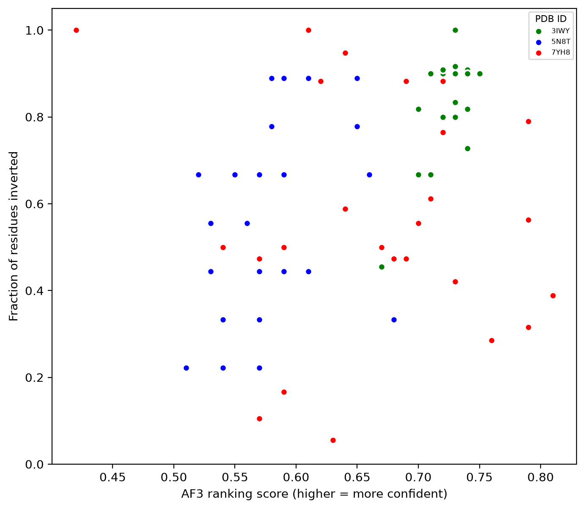

# Evaluating AlphaFold3's prediction of D-peptide—L-protein complexes

Checks whether AlphaFold 3 (AF3) keeps the chirality of D-amino acids when it
predicts a D-peptide bound to an L-protein. This is a replication of
Childs et al (2025) on some of the same structures (PDB: 7YH8, 5N8T, 3IWY) 

This builds AF3 jobs in SMILES format. After running these jobs, this compares
AF3's prediction with crystal structures from the PDB and calculates RMSDs and
chirality violations. A logistic regression is used to see whether secondary structure,
terminal residues, and hydrophobicity is related to chirality violations (AF3
predicting the wrong chirality of a residue's alpha carbon).

D-peptides are made of mirror-image (D) amino acids, so proteases can't easily
break them down, which makes them interesting as drugs. AF3 was trained almost
entirely on L-proteins so it is shown to fail to predict the chirality of D-peptides
when given their SMILES form, as in Childs et al (2025).


## Results

I ran AF3 with seeds 1–5 giving 25 predictions for the three complexes. 58 of the 1,000
residue predictions were too flat to call as D or L (abs(triple product) < 1.0 Å^3) and are not considered
as chirality violations.

| Complex | Peptide residues | Chirality violation rate (%) | Shape RMSD (Å) | Binding pose RMSD (Å) | Protein RMSD (Å) |
| ------- | ---------------- | ------------------------ | -------------- | --------------------- | ---------------- |
| 7YH8    | 19               | 57                       | 3.16 ± 0.72    | 26.8 ± 5.3            | 0.97 ± 0.20      |
| 5N8T    | 9                | 59                       | 3.10 ± 0.56    | 8.0 ± 1.3             | 2.27 ± 0.56      |
| 3IWY    | 12               | 84                       | 3.14 ± 0.14    | 4.1 ± 0.3             | 0.45 ± 0.04      |


### Chirality
My chirality violation rates for 7YH8 and 5N8T are close to the 52% and 51% reported by Childs et al.
(2025), but my 3IWY rate is much higher than their 50%. All five seeds for 3IWY reports chirality
violation rate of 79–91%, so it isn't due to an outlier. This might be because Childs et al. built 
the SMILES from the sequence whilst I built them from the crystal coordinates.

### Fold and binding pose
The D-peptide's conformation was about 3Å different in all three complexes (shape RMSD). The L-protein 
was predicted well (0.5–2.3Å). The binding pose RMSD difference is due to AF3 incorrectly placing the
D-peptide. For 7YH8, the binding pose RMSD was on average 26.8Å from its crystal position since it was
predicted to bind on the opposite side of the L-protein. 3IWY had the best predicted binding pose (~4Å)
despite the highest violation rate. Looking at the .cif files, this aligns with the results in Childs et al.


### AF3 confidence



AF3's confidence score does not warn about chirality violations. The 3IWY predictions had both the highest
ranking scores (0.67–0.75) and the highest violation rates. 

### Features predicting chirality violations

| Complex | α-helix      | Loop       | Terminus   |
| ------- | ------------ | ---------- | ---------- |
| 7YH8    | 58% (n=408)  | –          | 43% (n=40) |
| 5N8T    | 66% (n=125)  | 56% (n=50) | 46% (n=50) |
| 3IWY    | 94% (n=221)  | 0% (n=23)  | 68% (n=25) |


| Term                                   | Odds ratio | p      |
| -------------------------------------- | ---------- | ------ |
| Loop (vs α-helix)                      | 0.17       | 0.09   |
| Terminus (vs α-helix)                  | 0.48       | 0.19   |
| Hydrophobicity                         | 1.03       | 0.33   |
| Terminal residue (first or last 2)     | 0.76       | 0.60   |
| 5N8T (vs 3IWY)                         | 0.40       | 0.12   |
| 7YH8 (vs 3IWY)                         | 0.20       | < 0.01 |

No secondary structure or othe residue features predicted chirality violations significantly; the only significant 
difference was between 7YH8 and 3IWY complexes. 

### Limitations
- 3 complexes (40 peptide residues), compared with 13 systems and 3,255 predictions in Childs et al.
- 5N8T: only 9 of its 13 peptide residues are in the crystal, and streptavidin was given to AF3 as one chain.


## Usage

1. Define any number of complexes in `config.py` using the PDB ID, peptide chain, 
   protein chain, and D-residue names. You can also set if seeds, planar cutoff,
   number of residues to consider terminal residues and colours in the AF3 confidence
   vs. chirality violation rate plot

2. Set working directory to this folder and run `1. make_af3_job.py` first. The json 
   files will be in `data/af3_inputs/`.

3. Run AF3 on each job in then copy each output folder into `data/af3_results/`. The
   output folder is the job name e.g. `7YH8_B_dpeptide_complex`.

4. Run `2.evaluate_af3_results.py` and then `3.statistics.py`


## Requirements

- Python >= 3.12
- numpy, pandas, matplotlib, requests, biopython, statsmodels, scipy, rdkit

```
uv pip install -r pyproject.toml
```

- AlphaFold3 (local or HPC, not the web server)
## References

- Childs, H., Zhou, P. & Donald, B. R. AlphaFold 3 fails to predict D-peptide
  chirality, fold, and binding pose in heterochiral complexes. bioRxiv (2025).
  https://doi.org/10.1101/2025.03.14.643307


## Acknowledgements

AlphaFold3 was run in HKUST SuperPOD with guidance from Professor Nevin L. Zhang and Hao Wei.

I received help and guidance from research partners for using RDKit and Biopython.